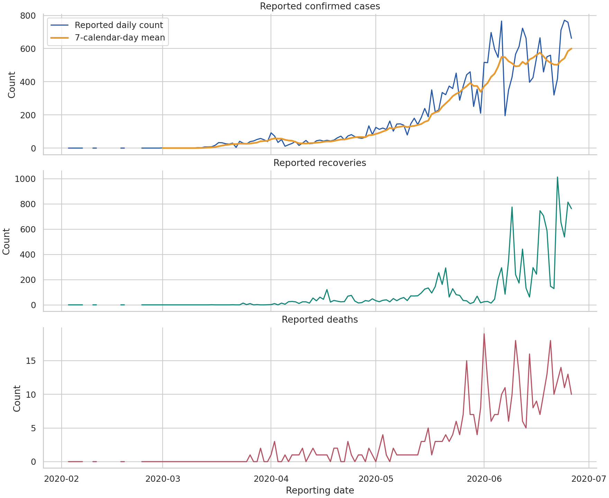
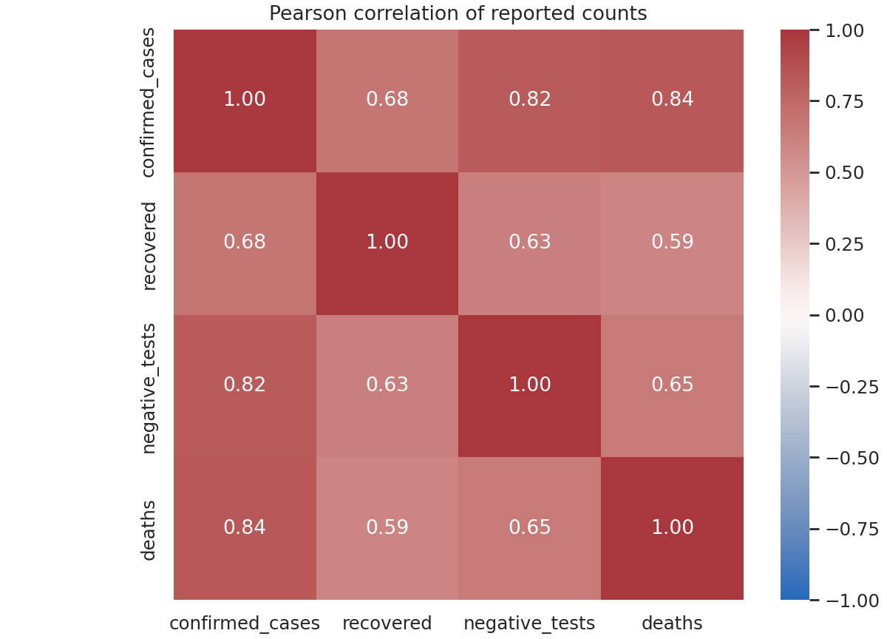
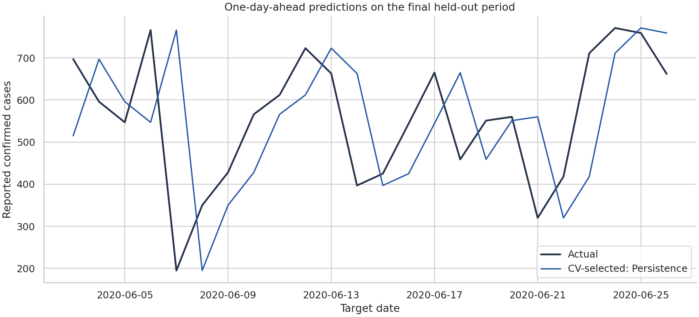

# COVID-19 Data Analysis in Armenia

A reproducible portfolio revision of a university team project, focused on data quality, exploratory analysis, visualization and honest model evaluation.

**Main notebook:** [COVID19_Armenia_Portfolio.ipynb](COVID19_Armenia_Portfolio.ipynb)

**Stack:** Python · Pandas · NumPy · Matplotlib · Seaborn · scikit-learn · Jupyter

## Project overview

Explore reported COVID-19 counts in Armenia, validate the input data, visualize trends and correlations, and evaluate a small one-day-ahead forecasting experiment against simple baselines.

The supplied data contains **134 observations** from **3 February to 26 June 2020**, with **11 missing calendar dates**, no missing cells and no exact duplicate rows. Missing reporting dates are not treated as zero. Counts are interpreted as daily reports because they are non-monotonic; the CSV does not contain an authoritative data dictionary, so this interpretation should be verified against the upstream source before operational use.

## My contribution and team credit

The original team presentation attributes **trend analysis, visualizations and model evaluation** to **Vane Sargsyan**.

| Team member | Contribution in the original coursework |
|---|---|
| Mariam (Մարիամ) | Data preprocessing, feature engineering and dataset preparation |
| Vane (Վանե) | Trend analysis, visualizations and model evaluation |
| Knarik (Քնարիկ) | Exploratory data analysis and prediction generation |
| Elen (Էլեն) | Model selection and implementation, result visualization and best-model summary |

This is a revised presentation of team coursework, not a claim of sole authorship. Portfolio corrections and added baselines are described in [CHANGELOG.md](CHANGELOG.md). The original submission and slides remain unchanged outside this package.

## Analysis preview





The largest reported confirmed-case count in this sample is **771 on 24 June 2020**. The same-date confirmed/deaths Pearson correlation is approximately **0.835**. This association does not establish causation and may reflect shared trends and reporting patterns.

## Evaluation design

- Predict calendar day t+1 using reports available at the end of day t.
- Use calendar-based lags and complete seven-day windows; retain unknown dates as missing.
- After filtering, use 116 supervised rows: 92 training rows and 24 held-out rows.
- Evaluate on target dates **3–26 June 2020**.
- Select using three chronological validation folds inside training only, with a one-row gap.
- Fit scaling inside the Linear Regression pipeline. Do not scale the target.
- Compare persistence, the training-target mean, Linear Regression and tuned Random Forest.
- Generate rolling one-step predictions using each newly observed day's features; this is not a 24-day forecast made at a single origin.

## Recomputed results

| Model | MAE (cases) | RMSE (cases) | R² |
|---|---:|---:|---:|
| Persistence | 139.62 | 183.08 | -0.440 |
| Training mean | 443.33 | 468.85 | -8.443 |
| Linear Regression | 188.38 | 234.61 | -1.365 |
| Random Forest | 183.83 | 211.91 | -0.929 |

Persistence (tomorrow equals today) was selected by training-only cross-validation and also had the lowest held-out MAE in this experiment. All held-out R² values are negative. The models do not demonstrate dependable forecasting performance on this short dataset. MAE and RMSE are in reported cases, unlike the old standardized-target experiment; old slide metrics are not comparable.



The forecasting section illustrates evaluation and limitations. The portfolio's strongest evidence is the reproducible data review, visualization and interpretation.

## Run locally

Use Python 3.11 or newer; the captured run used Python 3.12.14 and the package versions pinned in `requirements.txt`.

```bash
python -m venv .venv
source .venv/bin/activate
python -m pip install -r requirements.txt
jupyter notebook
```

On Windows, activate with `.venv\Scripts\activate`. Open the notebook from this project directory and select **Restart Kernel and Run All Cells**.

In Google Colab, upload the notebook and `data/Armenian_COVID_Data.csv` to the session (the CSV may sit beside the notebook), then run all cells. Colab's preinstalled library versions may differ; use the pinned requirements if exact reproduction is needed.

## Included files

| Path | Purpose |
|---|---|
| `COVID19_Armenia_Portfolio.ipynb` | Executed analysis, tables, charts and explanations |
| `data/Armenian_COVID_Data.csv` | Unmodified user-supplied source CSV |
| `requirements.txt` | Analysis package versions and Jupyter dependency |
| `reports/data_quality.csv` | Quality-check summary |
| `reports/validated_observations.csv` | Parsed and validated observations |
| `reports/correlations.csv` | Original-count correlations |
| `reports/cross_validation.csv` | Training-only chronological validation scores |
| `reports/model_metrics.csv` | Recomputed held-out metrics |
| `reports/test_predictions.csv` | Targets and predictions for the held-out period |
| `reports/figures/` | Four charts generated by the notebook |
| `CHANGELOG.md` | Revision record and differences from the submission |

## Limitations and data source

This small historical dataset cannot support claims of production-ready pandemic forecasting. It does not model reporting delays, changes in testing or policy interventions. The Random Forest cross-validation score is also used for tuning, so it is not an independent estimate. No causal or medical conclusions are drawn.

Coursework source credit: [Natalya Bakhshetyan, COVID-19 in Armenia, Kaggle](https://www.kaggle.com/datasets/natalyabakhshetyan/covid19-in-armenia). The provided CSV does not include a license. Check the source's redistribution terms before publishing the CSV or derived data; this package does not assign a new license to third-party data or team contributions.

Method references: [scikit-learn common pitfalls](https://scikit-learn.org/stable/common_pitfalls.html), [TimeSeriesSplit](https://scikit-learn.org/stable/modules/generated/sklearn.model_selection.TimeSeriesSplit.html).
